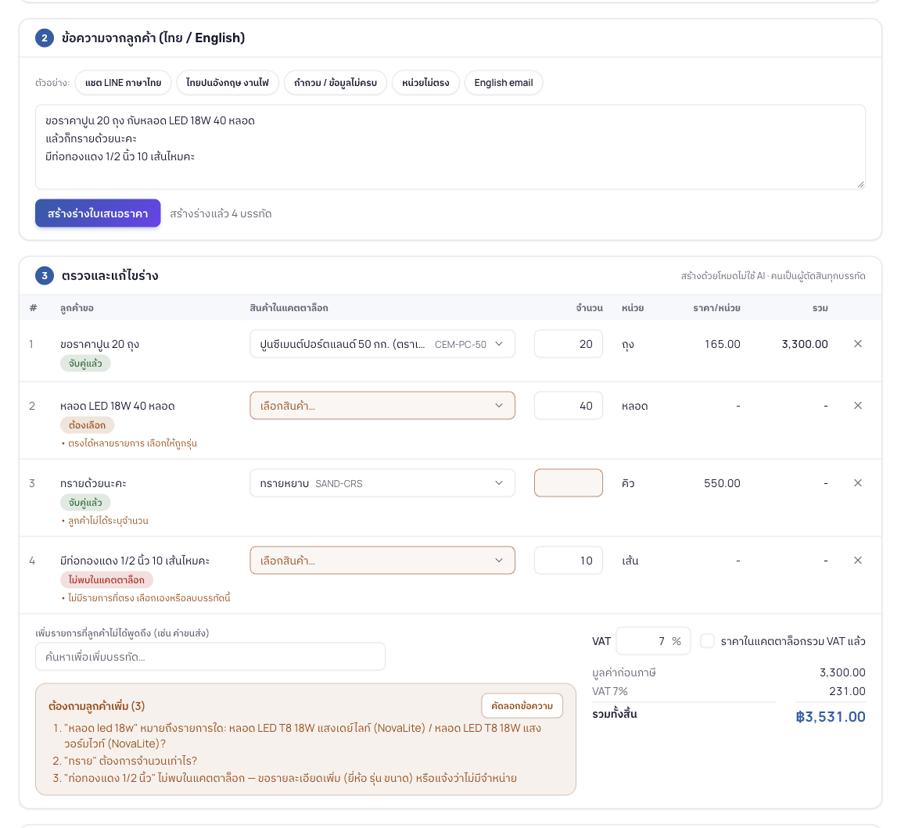

# eve Thai Quotation Extension

Turn a customer's message, in Thai or English, into a quotation priced from your own catalog. A person approves before anything goes out.

[](https://github.com/mintelligence-dev/eve-thai-quotation-extension/actions/workflows/ci.yml)
[](LICENSE)
[](https://www.npmjs.com/package/@eve-thai-quotation-extension/core)
[](https://www.npmjs.com/package/@eve-thai-quotation-extension/eve)
[](https://www.typescriptlang.org)

**English** · [ภาษาไทย](README.th.md)

[](https://thai-quotation-agent.vercel.app)

## What is in this repository

| | What it is | Where it runs | Try it |
|---|---|---|---|
| [`packages/eve`](packages/eve) | An extension for [eve](https://eve.dev) agents: tools to draft, search, revise and issue a quotation, with approval before issuing | Any channel your eve agent has: Telegram, Slack, web chat and others | `eve add` (see [Quick start](#quick-start)) |
| [`packages/core`](packages/core) | The rules on their own: catalog import, Thai and English matching, review checks, pricing. No framework, no runtime dependencies | Any TypeScript project | `npm install @eve-thai-quotation-extension/core` |
| [`examples/thai-quotation-agent`](examples/thai-quotation-agent) | A complete agent built with the extension: a web page and a Telegram bot working on the same drafts and the same catalog | Web and Telegram | [thai-quotation-agent.vercel.app](https://thai-quotation-agent.vercel.app) |
All three price with the same code in `packages/core`.

## How it works

1. **A catalog** of products and prices, as CSV. The file is checked and every error is reported with its row and column.
2. **A customer's message**, from LINE, email or chat, in Thai, English or both.
3. **Matching.** Each requested item is matched to the catalog. Anything ambiguous ("cement" could be structural or plaster), missing a quantity, or in a different unit is flagged, with questions ready to send to the customer.
4. **Review.** A person changes items and quantities, adds or removes lines, and sets VAT.
5. **Approval.** Nothing is issued, printed or exported until a person approves.

## Safeguards

| Rule | How it is enforced |
|---|---|
| Prices only come from the catalog | The model's output has no price field. Prices are looked up by SKU in one place, `priceQuotation()`. |
| No invented products | The model may only answer with a SKU from that line's shortlist. Anything else is rejected and the line goes back to the reviewer. |
| A person approves | A draft can be approved only when every line has an item and a quantity and unit mismatches are confirmed. In the extension, issuing is a tool call that eve pauses for approval, and it is refused if the total changed after the approver saw it. |
| Sample data is made up | All catalogs, brands and messages under `samples/` are fictional. |

With `sharing` on, the extension keeps drafts in storage, and the example agent does the same on the server. Read the [extension README](packages/eve) and the [example's README](examples/thai-quotation-agent#who-can-do-what) before putting real prices in.

## Quick start

### Add quotations to an eve agent

Needs Node 24 or newer and an eve project (`npx eve@latest init my-agent`).

```bash
eve add https://cdn.jsdelivr.net/npm/@eve-thai-quotation-extension/eve/r/quotation.json
```

This installs the package and writes `agent/extensions/quotation.ts` and a sample `data/catalog.csv`. Put in your own catalog, choose who approves, and the agent can quote on every channel it has. Settings, approval rules and limits are in the [extension README](packages/eve).

To see it working with a web page and Telegram, start from the [example agent](examples/thai-quotation-agent).

### Use the rules in your own code

```bash
npm install @eve-thai-quotation-extension/core
```

```ts
import { buildDraft, canApprove, parseCatalogCsv, priceQuotation } from "@eve-thai-quotation-extension/core";

const { items: catalog, errors } = parseCatalogCsv(csvText);
const draft = await buildDraft({ inquiry: "ขอราคาท่อฟ้า 4 หุน 50 เส้น กับ breaker 20A 6 ตัว", catalog });
// …a person reviews: chooseItem() / setQuantity() / acknowledgeUnit()…
if (canApprove(draft, catalog).ok) {
  const quote = priceQuotation(draft, catalog, { vatRateBps: 700, pricesIncludeVat: false });
}
```

Without a model, `buildDraft` reads the message with built-in rules. To use a model, pass `createLlmExtractor` and `createLlmSelector` from `@eve-thai-quotation-extension/core/llm`.

### Run the example

The [example agent](examples/thai-quotation-agent) has a web page and a Telegram bot. Its README covers running it locally, deploying it to Vercel, and who can do what on a deployment.

Deploy your own copy to Vercel. The button asks for the catalog password and a capped AI key, and creates the private Blob store; every variable is explained [in the example's README](examples/thai-quotation-agent#deploy-to-vercel):

[](https://vercel.com/new/clone?repository-url=https%3A%2F%2Fgithub.com%2Fmintelligence-dev%2Feve-thai-quotation-extension%2Ftree%2Fmain%2Fexamples%2Fthai-quotation-agent&project-name=thai-quotation-agent&repository-name=thai-quotation-agent&env=QUOTATION_ADMIN_PASSWORD%2CAI_GATEWAY_API_KEY&envDescription=QUOTATION_ADMIN_PASSWORD%3A%20the%20password%20for%20the%20%2Fcatalog%20page%2C%20where%20prices%20are%20changed.%20AI_GATEWAY_API_KEY%3A%20an%20AI%20Gateway%20key%20with%20a%20spending%20limit%2C%20because%20anyone%20who%20can%20open%20the%20page%20can%20use%20AI%20mode.&envLink=https%3A%2F%2Fgithub.com%2Fmintelligence-dev%2Feve-thai-quotation-extension%2Ftree%2Fmain%2Fexamples%2Fthai-quotation-agent%23environment-variables&stores=%5B%7B%22type%22%3A%22blob%22%2C%22access%22%3A%22private%22%7D%5D)

## Catalog format

| Column | Required | Example |
|---|---|---|
| `sku` | yes | `PVC-050-85` |
| `name` | yes | `ท่อ PVC สีฟ้า 1/2 นิ้ว ชั้น 8.5` |
| `unit` | yes | `เส้น` |
| `unit_price` | yes | `62.00` or `"1,250.00"` (at most 2 decimals) |
| `name_en` | | `PVC pipe 1/2 inch` |
| `aliases` | | `ท่อฟ้า 4 หุน\|ท่อ pvc 4 หุน`, separated by `\|` |
| `category` | | `ท่อและข้อต่อ` |

- Thai headers are accepted, for example `รหัสสินค้า, ชื่อสินค้า, หน่วย, ราคา`.
- The file must be UTF-8. In Excel choose "CSV UTF-8". A Windows-874 file is refused with a message that says how to save it again.
- `aliases` are the biggest accuracy lever. Put in the words customers really use.

## Money rules

- All amounts are integer satang, so there is no floating-point drift.
- Line total = unit price × quantity, rounded half up to the satang. Quantities may have decimals.
- **VAT is computed once on the document total**, not per line, and rounded half up.
  - Prices exclude VAT: VAT = sum × rate.
  - Prices include VAT: VAT = sum × rate ÷ (1 + rate).
- The VAT rate is configurable (default 7%). The Thai amount in words comes from `bahtText`.

## Costs

The rules in `core` cost nothing to run. A model is paid per token, for example through [AI Gateway](https://vercel.com/docs/ai-gateway).

With `core`'s own extractor and selector, one message takes two model calls: one to read the lines and one to choose items. From the real prompt size of a 6-line sample (about 3,400 characters plus schemas) we estimate about 3,000 input and 800 output tokens per message. This was not measured from live calls, and Thai uses more tokens per character than English.

| Model | Input / output per 1M tokens* | About, per message |
|---|---|---|
| `anthropic/claude-haiku-5.5` (default) | $0.10 / $0.50 | $0.0007 |
| `google/gemini-3.5-flash-lite` | $0.30 / $2.50 | $0.003 |
| `anthropic/claude-sonnet-5.5` | $2.00 / $10.00 | $0.014 |

\* From `https://ai-gateway.vercel.sh/v1/models` on 2026-10-21. Prices change; see <https://vercel.com/ai-gateway/models>.

An eve agent uses more than this per message, because it takes several model turns to read, call tools and reply. We have not measured that.

## Known limits

- No unit conversion (box ↔ piece). A unit mismatch is flagged for a person to confirm.
- No discounts or tiered prices.
- Matching without a model can misread a line where a spec with a unit comes before the quantity, such as "ปูน 50 กก. ตราเพชรา 10 ถุง". A model handles that better.
- The extension issues the quotation as text. The example agent has a printable page; it does not make a PDF on the server.

What was and was not tested is listed in the [extension README](packages/eve#what-was-tested) and the [example's README](examples/thai-quotation-agent#what-was-tested).

## Repository layout

```
packages/core/                  the rules: CSV, matching, review, money (+ tests)
packages/eve/                   the eve extension: tools, instructions, desk API (+ tests)
examples/thai-quotation-agent/  an eve agent with a web page and a Telegram channel; a project of its own
samples/                        fictional catalogs and messages, used by the tests
scripts/                        a script for trying the samples
```

## Development

Needs Node 24 or newer.

| Command | |
|---|---|
| `npm install` | Install everything in the workspace |
| `npm test` | Unit tests for the rules and the extension |
| `npm run typecheck` · `npm run lint` | Type and lint checks |
| `npm run build:eve` | Build the extension |
| `npm run try-samples` | Show how each sample message matches, without a model |

The example agent is outside the workspace: run its commands from inside its folder.

## Contributing

Issues and pull requests are welcome, in English or Thai. Read [CONTRIBUTING.md](CONTRIBUTING.md) first; it is short. Everyone taking part is expected to follow the [Code of Conduct](CODE_OF_CONDUCT.md).

Found a security problem? Do not open a public issue. See [SECURITY.md](SECURITY.md).

Changes in each release are in [CHANGELOG.md](CHANGELOG.md).

## Credits

- [eve](https://eve.dev) by Vercel, the agent framework the extension is built for.
- [Mintel UI](https://mintel-ui.vercel.app), the theme and components of the example, on [Radix UI](https://www.radix-ui.com) and [shadcn/ui](https://ui.shadcn.com).
- [Next.js](https://nextjs.org), [AI SDK](https://ai-sdk.dev), [Zod](https://zod.dev), [Tailwind CSS](https://tailwindcss.com) and [Vitest](https://vitest.dev).

## License

[MIT](LICENSE) © 2026 M Intelligence
