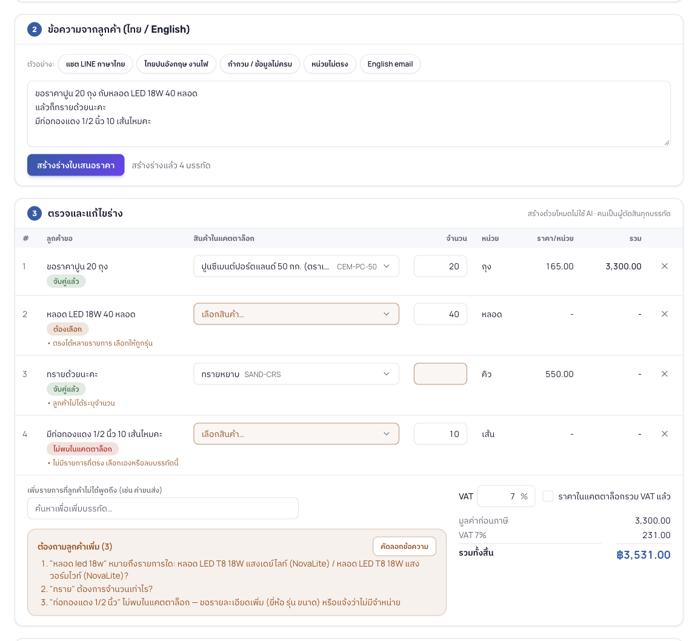

# eve Thai Quotation Extension

เปลี่ยนข้อความของลูกค้า ทั้งภาษาไทยและภาษาอังกฤษ ให้เป็นใบเสนอราคาที่คิดราคาจากแคตตาล็อกของคุณเอง และต้องมีคนอนุมัติก่อนส่งออกทุกครั้ง

[](https://github.com/mintelligence-dev/eve-thai-quotation-extension/actions/workflows/ci.yml)
[](LICENSE)
[](https://www.npmjs.com/package/@eve-thai-quotation-extension/core)
[](https://www.npmjs.com/package/@eve-thai-quotation-extension/eve)
[](https://www.typescriptlang.org)

[English](README.md) · **ภาษาไทย**

[](https://thai-quotation-agent.vercel.app)

**[ลองใช้ →](https://thai-quotation-agent.vercel.app)** หรือ deploy agent ตัวอย่างเป็นของคุณเอง ปุ่มจะให้กรอกรหัสผ่านหน้าแคตตาล็อกและ key ของ AI ที่ตั้งงบไว้ แล้วสร้างที่เก็บข้อมูลให้ ([ค่าแต่ละตัวทำอะไร](examples/thai-quotation-agent#deploy-to-vercel))

[](https://vercel.com/new/clone?repository-url=https%3A%2F%2Fgithub.com%2Fmintelligence-dev%2Feve-thai-quotation-extension%2Ftree%2Fmain%2Fexamples%2Fthai-quotation-agent&project-name=thai-quotation-agent&repository-name=thai-quotation-agent&env=QUOTATION_ADMIN_PASSWORD%2CAI_GATEWAY_API_KEY&envDescription=QUOTATION_ADMIN_PASSWORD%3A%20the%20password%20for%20the%20%2Fcatalog%20page%2C%20where%20prices%20are%20changed.%20AI_GATEWAY_API_KEY%3A%20an%20AI%20Gateway%20key%20with%20a%20spending%20limit%2C%20because%20anyone%20who%20can%20open%20the%20page%20can%20use%20AI%20mode.&envLink=https%3A%2F%2Fgithub.com%2Fmintelligence-dev%2Feve-thai-quotation-extension%2Ftree%2Fmain%2Fexamples%2Fthai-quotation-agent%23environment-variables&stores=%5B%7B%22type%22%3A%22blob%22%2C%22access%22%3A%22private%22%7D%5D)

## ใน repository นี้มีอะไร

| | คืออะไร | ใช้ได้ที่ไหน | ลองใช้ |
|---|---|---|---|
| [`packages/eve`](packages/eve) | extension สำหรับ agent ที่สร้างด้วย [eve](https://eve.dev): เครื่องมือร่าง ค้นหา แก้ไข และออกใบเสนอราคา โดยต้องอนุมัติก่อนออก | ทุกช่องทางที่ agent ของคุณมี เช่น Telegram, Slack, แชตบนเว็บ | `eve add` (ดู[เริ่มใช้งาน](#เริ่มใช้งาน)) |
| [`packages/core`](packages/core) | ตัวกฎล้วน ๆ: นำเข้าแคตตาล็อก จับคู่สินค้าไทยและอังกฤษ ตรวจร่าง คิดราคา ไม่ผูกกับ framework ใด | โปรเจกต์ TypeScript ใดก็ได้ | `npm install @eve-thai-quotation-extension/core` |
| [`examples/thai-quotation-agent`](examples/thai-quotation-agent) | agent ตัวอย่างที่ใช้ extension ครบชุด: หน้าเว็บกับ bot Telegram ทำงานกับร่างและแคตตาล็อกชุดเดียวกัน | เว็บและ Telegram | [thai-quotation-agent.vercel.app](https://thai-quotation-agent.vercel.app) · [deploy ของคุณเอง](examples/thai-quotation-agent#deploy-to-vercel) |
ทั้งสามส่วนคิดราคาด้วยโค้ดชุดเดียวกันใน `packages/core`

## ทำงานอย่างไร

1. **แคตตาล็อก** สินค้าและราคาเป็นไฟล์ CSV ระบบตรวจไฟล์และบอกว่าผิดที่แถวไหน คอลัมน์ไหน
2. **ข้อความของลูกค้า** จาก LINE อีเมล หรือแชต เป็นภาษาไทย ภาษาอังกฤษ หรือปนกัน
3. **จับคู่** แต่ละรายการที่ลูกค้าขอกับสินค้าในแคตตาล็อก รายการที่กำกวม (เช่น "ปูน" เป็นได้ทั้งปูนโครงสร้างและปูนฉาบ) ไม่ระบุจำนวน หรือหน่วยไม่ตรง จะถูกชี้ให้เห็น พร้อมคำถามที่ส่งไปถามลูกค้าได้ทันที
4. **ตรวจร่าง** คนเปลี่ยนสินค้า แก้จำนวน เพิ่มหรือลบบรรทัด และตั้ง VAT
5. **อนุมัติ** ระบบไม่ออกใบ ไม่พิมพ์ และไม่ส่งออก จนกว่าคนจะอนุมัติ

## หลักความปลอดภัย

| กฎ | บังคับใช้อย่างไร |
|---|---|
| ราคามาจากแคตตาล็อกเท่านั้น | ผลลัพธ์ของ AI ไม่มีช่องราคา ราคาถูกดึงตามรหัสสินค้าที่จุดเดียวคือ `priceQuotation()` |
| ไม่สร้างสินค้าขึ้นเอง | AI ตอบได้แค่รหัสที่อยู่ในรายการคัดเลือกของบรรทัดนั้น ถ้าตอบอย่างอื่น ระบบปฏิเสธและส่งบรรทัดนั้นกลับให้คนเลือก |
| คนเป็นผู้อนุมัติ | อนุมัติได้เมื่อทุกบรรทัดมีสินค้าและจำนวน และยืนยันหน่วยที่ไม่ตรงแล้ว ใน extension การออกใบเป็นการเรียกเครื่องมือที่ eve หยุดรอการอนุมัติ และจะถูกปฏิเสธถ้ายอดเปลี่ยนหลังจากผู้อนุมัติเห็น |
| ข้อมูลตัวอย่างเป็นของสมมติ | แคตตาล็อก ยี่ห้อ และข้อความทั้งหมดใน `samples/` แต่งขึ้น |

เมื่อเปิด `sharing` extension จะเก็บร่างไว้ในที่เก็บข้อมูล และ agent ตัวอย่างก็เก็บไว้บนเซิร์ฟเวอร์เช่นกัน ควรอ่าน [README ของ extension](packages/eve) และ [README ของตัวอย่าง](examples/thai-quotation-agent#who-can-do-what) ก่อนใส่ราคาจริง

## เริ่มใช้งาน

### เพิ่มความสามารถทำใบเสนอราคาให้ agent ของ eve

ต้องใช้ Node 24 ขึ้นไป และมีโปรเจกต์ eve (`npx eve@latest init my-agent`)

```bash
eve add https://cdn.jsdelivr.net/npm/@eve-thai-quotation-extension/eve/r/quotation.json
```

คำสั่งนี้ติดตั้ง package และเขียนไฟล์ `agent/extensions/quotation.ts` กับแคตตาล็อกตัวอย่าง `data/catalog.csv` ให้ ใส่แคตตาล็อกของคุณ กำหนดว่าใครอนุมัติได้ แล้ว agent จะเสนอราคาได้ในทุกช่องทางที่มี รายละเอียดการตั้งค่า กฎการอนุมัติ และข้อจำกัด อยู่ใน [README ของ extension](packages/eve) (ภาษาอังกฤษ)

ถ้าอยากเห็นการใช้งานจริงพร้อมหน้าเว็บและ Telegram ให้เริ่มจาก [agent ตัวอย่าง](examples/thai-quotation-agent)

### ใช้กฎในโค้ดของคุณเอง

```bash
npm install @eve-thai-quotation-extension/core
```

```ts
import { buildDraft, canApprove, parseCatalogCsv, priceQuotation } from "@eve-thai-quotation-extension/core";

const { items: catalog, errors } = parseCatalogCsv(csvText);
const draft = await buildDraft({ inquiry: "ขอราคาท่อฟ้า 4 หุน 50 เส้น กับ breaker 20A 6 ตัว", catalog });
// …ให้คนตรวจ: chooseItem() / setQuantity() / acknowledgeUnit()…
if (canApprove(draft, catalog).ok) {
  const quote = priceQuotation(draft, catalog, { vatRateBps: 700, pricesIncludeVat: false });
}
```

ถ้าไม่ใช้ AI `buildDraft` จะอ่านข้อความด้วยกฎที่มีในตัว ถ้าจะใช้ AI ให้ส่ง `createLlmExtractor` และ `createLlmSelector` จาก `@eve-thai-quotation-extension/core/llm`

### รันตัวอย่าง

[agent ตัวอย่าง](examples/thai-quotation-agent) มีหน้าเว็บและ bot Telegram README ของตัวอย่างอธิบายวิธีรันในเครื่อง วิธี deploy ขึ้น Vercel และใครทำอะไรได้บ้างบนระบบที่ deploy แล้ว

deploy ขึ้น Vercel ของคุณเองได้ด้วยปุ่มเดียว ปุ่มจะให้กรอกรหัสผ่านหน้าแคตตาล็อกและ key ของ AI ที่ตั้งงบไว้ แล้วสร้าง Blob store แบบ private ให้ ตัวแปรทุกตัวอธิบายไว้[ใน README ของตัวอย่าง](examples/thai-quotation-agent#deploy-to-vercel)

[](https://vercel.com/new/clone?repository-url=https%3A%2F%2Fgithub.com%2Fmintelligence-dev%2Feve-thai-quotation-extension%2Ftree%2Fmain%2Fexamples%2Fthai-quotation-agent&project-name=thai-quotation-agent&repository-name=thai-quotation-agent&env=QUOTATION_ADMIN_PASSWORD%2CAI_GATEWAY_API_KEY&envDescription=QUOTATION_ADMIN_PASSWORD%3A%20the%20password%20for%20the%20%2Fcatalog%20page%2C%20where%20prices%20are%20changed.%20AI_GATEWAY_API_KEY%3A%20an%20AI%20Gateway%20key%20with%20a%20spending%20limit%2C%20because%20anyone%20who%20can%20open%20the%20page%20can%20use%20AI%20mode.&envLink=https%3A%2F%2Fgithub.com%2Fmintelligence-dev%2Feve-thai-quotation-extension%2Ftree%2Fmain%2Fexamples%2Fthai-quotation-agent%23environment-variables&stores=%5B%7B%22type%22%3A%22blob%22%2C%22access%22%3A%22private%22%7D%5D)

## รูปแบบแคตตาล็อก

| คอลัมน์ | จำเป็น | ตัวอย่าง |
|---|---|---|
| `sku` | ใช่ | `PVC-050-85` |
| `name` | ใช่ | `ท่อ PVC สีฟ้า 1/2 นิ้ว ชั้น 8.5` |
| `unit` | ใช่ | `เส้น` |
| `unit_price` | ใช่ | `62.00` หรือ `"1,250.00"` (ทศนิยมไม่เกิน 2 ตำแหน่ง) |
| `name_en` | | `PVC pipe 1/2 inch` |
| `aliases` | | `ท่อฟ้า 4 หุน\|ท่อ pvc 4 หุน` คั่นด้วย `\|` |
| `category` | | `ท่อและข้อต่อ` |

- ใช้หัวคอลัมน์ภาษาไทยได้ เช่น `รหัสสินค้า, ชื่อสินค้า, หน่วย, ราคา`
- ไฟล์ต้องเป็น UTF-8 ใน Excel ให้เลือก "CSV UTF-8" ถ้าเป็นไฟล์ Windows-874 ระบบจะไม่รับและบอกวิธีบันทึกใหม่
- ช่อง `aliases` ช่วยให้จับคู่แม่นที่สุด ให้ใส่คำที่ลูกค้าใช้เรียกจริง เช่น "ท่อฟ้า", "ลูกย่อย", "หลอดปิงปอง"

## การคำนวณเงิน

- เก็บเงินเป็นสตางค์ (จำนวนเต็ม) ทั้งระบบ จึงไม่มีปัญหาทศนิยมคลาดเคลื่อน
- ยอดต่อบรรทัด = ราคาต่อหน่วย × จำนวน ปัดครึ่งขึ้นเป็นสตางค์ จำนวนมีทศนิยมได้
- **คิด VAT ครั้งเดียวจากยอดรวมทั้งเอกสาร** ไม่ได้คิดทีละบรรทัด แล้วปัดครึ่งขึ้น
  - ราคายังไม่รวม VAT: VAT = ยอดรวม × อัตรา
  - ราคารวม VAT แล้ว: VAT = ยอดรวม × อัตรา ÷ (1 + อัตรา)
- ตั้งอัตรา VAT ได้ (ค่าเริ่มต้น 7%) จำนวนเงินตัวอักษรภาษาไทยมาจาก `bahtText`

## ค่าใช้จ่าย

กฎใน `core` ไม่มีค่าใช้จ่ายในการรัน ส่วนโมเดลคิดตามจำนวน token เช่น ผ่าน [AI Gateway](https://vercel.com/docs/ai-gateway)

เมื่อใช้ตัวอ่านและตัวเลือกสินค้าของ `core` ข้อความหนึ่งข้อความเรียกโมเดล 2 ครั้ง คืออ่านรายการ 1 ครั้ง และเลือกสินค้า 1 ครั้ง ประเมินจากขนาด prompt จริงของข้อความตัวอย่าง 6 บรรทัด (ประมาณ 3,400 ตัวอักษร รวม schema) ได้ราว 3,000 input tokens และ 800 output tokens ต่อข้อความ ตัวเลขนี้ไม่ได้วัดจากการเรียกจริง และภาษาไทยใช้ token ต่อตัวอักษรมากกว่าภาษาอังกฤษ

| โมเดล | ราคา input / output ต่อ 1M token* | ประมาณต่อข้อความ |
|---|---|---|
| `anthropic/claude-haiku-5.5` (ค่าเริ่มต้น) | $0.10 / $0.50 | $0.0007 |
| `google/gemini-3.5-flash-lite` | $0.30 / $2.50 | $0.003 |
| `anthropic/claude-sonnet-5.5` | $2.00 / $10.00 | $0.014 |

\* จาก `https://ai-gateway.vercel.sh/v1/models` เมื่อ 21 ต.ค. 2569 ราคาเปลี่ยนได้ ดูล่าสุดที่ <https://vercel.com/ai-gateway/models>

agent ของ eve ใช้มากกว่านี้ต่อข้อความ เพราะต้องคิดหลายรอบเพื่ออ่าน เรียกเครื่องมือ และตอบ เรายังไม่ได้วัดตัวเลขนี้

## ข้อจำกัด

- ยังไม่แปลงหน่วย (เช่น กล่อง ↔ ชิ้น) ถ้าหน่วยไม่ตรง ระบบชี้ให้คนยืนยัน
- ยังไม่มีส่วนลดหรือราคาขั้นบันได
- การจับคู่แบบไม่ใช้โมเดลอาจอ่านผิด เมื่อสเปกที่มีหน่วยมาก่อนจำนวน เช่น "ปูน 50 กก. ตราเพชรา 10 ถุง" ซึ่ง AI จัดการได้ดีกว่า
- extension ออกใบเสนอราคาเป็นข้อความ agent ตัวอย่างมีหน้าสำหรับพิมพ์ แต่ยังไม่สร้างไฟล์ PDF บนเซิร์ฟเวอร์

สิ่งที่ทดสอบแล้วและยังไม่ได้ทดสอบ อยู่ใน [README ของ extension](packages/eve#what-was-tested) และ [README ของตัวอย่าง](examples/thai-quotation-agent#what-was-tested)

## โครงสร้าง repository

```
packages/core/                  ตัวกฎ: CSV การจับคู่ การตรวจร่าง การคิดเงิน (+ tests)
packages/eve/                   extension ของ eve: เครื่องมือ คำสั่งสำหรับ agent และ desk API (+ tests)
examples/thai-quotation-agent/  agent ของ eve พร้อมหน้าเว็บและช่องทาง Telegram เป็นโปรเจกต์แยก
samples/                        แคตตาล็อกและข้อความสมมติ ที่ test ใช้
scripts/                        สคริปต์สำหรับลองข้อความตัวอย่าง
```

## การพัฒนา

ต้องใช้ Node 24 ขึ้นไป

| คำสั่ง | |
|---|---|
| `npm install` | ติดตั้งทั้ง workspace |
| `npm test` | unit test ของกฎและ extension |
| `npm run typecheck` · `npm run lint` | ตรวจ type และ lint |
| `npm run build:eve` | build extension |
| `npm run try-samples` | ดูผลจับคู่ของข้อความตัวอย่างแต่ละไฟล์ โดยไม่ใช้โมเดล |

agent ตัวอย่างอยู่นอก workspace ให้รันคำสั่งจากในโฟลเดอร์ของมันเอง

## ร่วมพัฒนา

ยินดีรับ issue และ pull request เขียนเป็นภาษาไทยหรือภาษาอังกฤษก็ได้ กรุณาอ่าน [CONTRIBUTING.md](CONTRIBUTING.md) ก่อน (สั้น ๆ) ผู้ร่วมพัฒนาทุกคนต้องปฏิบัติตาม [Code of Conduct](CODE_OF_CONDUCT.md)

พบช่องโหว่ด้านความปลอดภัย กรุณาอย่าเปิด issue สาธารณะ ดูวิธีแจ้งที่ [SECURITY.md](SECURITY.md)

การเปลี่ยนแปลงของแต่ละรุ่นอยู่ใน [CHANGELOG.md](CHANGELOG.md)

## ขอบคุณ

- [eve](https://eve.dev) ของ Vercel ซึ่งเป็น framework ของ agent ที่ extension นี้สร้างมาใช้ด้วย
- [Mintel UI](https://mintel-ui.vercel.app) theme และคอมโพเนนต์ของตัวอย่าง ซึ่งสร้างบน [Radix UI](https://www.radix-ui.com) และ [shadcn/ui](https://ui.shadcn.com)
- [Next.js](https://nextjs.org), [AI SDK](https://ai-sdk.dev), [Zod](https://zod.dev), [Tailwind CSS](https://tailwindcss.com) และ [Vitest](https://vitest.dev)

## สัญญาอนุญาต

[MIT](LICENSE) © 2026 M Intelligence  
นำไปใช้ แก้ไข และใช้เชิงพาณิชย์ได้ โดยต้องคงข้อความลิขสิทธิ์และสัญญาอนุญาตไว้ในสำเนาทุกชุด ซอฟต์แวร์นี้ให้ "ตามสภาพ" ไม่มีการรับประกันใด ๆ
